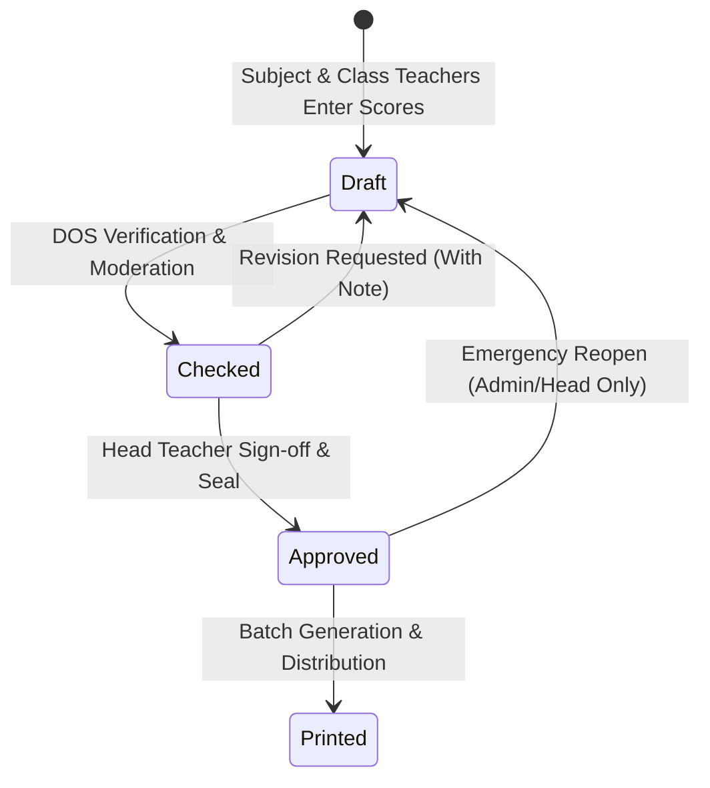

# ONE-PAGE PROPOSAL: MINIMAL REPORT CARD VERIFICATION LIFECYCLE

**Status:** PROPOSED FOR OWNER REVIEW AND APPROVAL  
**Target:** Jiddah Smart Report Engine  
**Implementation Constraint:** Zero code or schema mutations applied until approved by owner.

---

## 1. Architectural Motivation

Currently, the database stores raw mark rows in `circular_marks` and `theology_marks`, while report cards are synthesized on-the-fly at runtime. There is no intermediate verification gate, no status column recording whether marks were verified by the Director of Studies (DOS), and no immutable freeze preventing marks from changing after a Head Teacher signs or prints a report card.

This proposal introduces an explicit, lightweight **4-stage lifecycle** that mirrors real Ugandan school operations without unnecessary administrative overhead.

---

## 2. Proposed 4-Stage Lifecycle



| Lifecycle State | Description | Who Can View | Who Can Edit Marks |
|---|---|---|---|
| **`draft`** | Default state when marks entry begins for a term. Cohorts are incomplete or actively being edited. | Class Teacher, DOS, Head Teacher, Admin | Subject & Class Teachers |
| **`checked`** | DOS has verified that all subjects are entered, investigated score anomalies, and validated grading divisions. | Class Teacher, DOS, Head Teacher, Admin | DOS & Admin only |
| **`approved`** | Head Teacher has formally reviewed the cohort, verified remarks, and authorized publication. | All Staff | **FROZEN** (No mark edits permitted) |
| **`printed`** | Official PDF batch has been generated and timestamped for physical distribution to parents. | All Staff | **FROZEN** |

---

## 3. Role-Gated Transition Rules

Every state transition is strictly validated server-side by API route guards:

| Transition | Action Name | Required Role | Prerequisite Invariant Check |
|---|---|---|---|
| `draft` $\rightarrow$ `checked` | **Submit for Approval** | DOS Secular, DOS Theology, Admin | 0 missing marks for compulsory subjects; 0 unresolved negative marks. |
| `checked` $\rightarrow$ `approved` | **Authorize & Sign** | Head Teacher, Deputy Head Teacher, Admin | Signature image present for school; all teacher remarks populated. |
| `approved` $\rightarrow$ `printed` | **Mark as Printed** | Class Teacher, DOS, Head Teacher, Admin | Valid PDF export generated; print timestamp recorded. |
| `checked` $\rightarrow$ `draft` | **Request Revision** | DOS, Head Teacher, Admin | Mandatory `rejection_reason` text logged in audit trail. |
| `approved` $\rightarrow$ `draft` | **Emergency Unlock** | Administrator, Head Teacher | Mandatory high-severity audit log entry with justification. |

---

## 4. Proposed Database Schema Addition (Local-Only Migration Upon Approval)

```sql
CREATE TABLE public.report_lifecycle_states (
  id uuid PRIMARY KEY DEFAULT gen_random_uuid(),
  enrollment_id uuid NOT NULL REFERENCES public.enrollments(id) ON DELETE CASCADE,
  term_id uuid NOT NULL REFERENCES public.terms(id) ON DELETE CASCADE,
  status varchar(20) NOT NULL DEFAULT 'draft', -- 'draft', 'checked', 'approved', 'printed'
  checked_by uuid REFERENCES public.teachers(id),
  checked_at timestamptz,
  approved_by uuid REFERENCES public.teachers(id),
  approved_at timestamptz,
  printed_by uuid REFERENCES public.teachers(id),
  printed_at timestamptz,
  revision_notes text,
  created_at timestamptz DEFAULT now(),
  updated_at timestamptz DEFAULT now(),
  CONSTRAINT uq_enrollment_term_lifecycle UNIQUE (enrollment_id, term_id)
);

CREATE INDEX idx_report_lifecycle_status ON public.report_lifecycle_states(term_id, status);
```

---

## 5. UI Integration (Once Approved)

1. **Dashboard Control Room:** Replace static progress bars with live state counts (`Draft: 14`, `Checked: 8`, `Approved: 42`, `Printed: 68`).
2. **Report Center:** Display status pill next to student name with action buttons ("Submit to DOS", "Approve & Seal", "Print Batch").
3. **Marks Entry Lockout:** When a class is in `approved` or `printed`, marks grid displays a prominent banner: `"Cohort Locked: Approved by Head Teacher. Edits require DOS/Admin reopening."`
